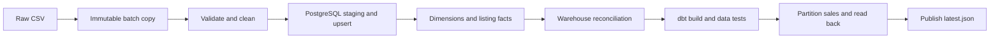

# Cars data pipeline

A batch data engineering project that turns vehicle-listing CSV files into a PostgreSQL warehouse, tested dbt sales reports, and partitioned Parquet exports.

## Repository layout

```text
cars-data-pipeline/
├── src/cars_data_pipeline/    # Importable application and CLI
│   ├── pipeline.py           # Stage execution, audit, successful-output manifest
│   ├── config.py             # Shared paths and database configuration
│   ├── setup_database.py     # Schema bootstrap
│   ├── transform.py          # Data contracts and cleaning
│   ├── load_source.py        # COPY and source upserts
│   ├── load_warehouse.py     # Dimension and fact loading
│   ├── validate_warehouse.py # Source-to-warehouse reconciliation
│   └── partition_sales.py    # Partitioned Parquet export
├── dbt/                      # Sources, staging models, marts, SQL tests
├── sql/
│   ├── 001_schema.sql        # Reproducible table definitions
│   ├── reporting/            # Earlier reporting exercises
│   └── analysis/             # Exploratory analytical SQL
├── orchestration/kestra/     # Kestra infrastructure and saved flows
├── scripts/exploration/     # Original data inspection and exploration scripts
├── tests/
│   ├── unit/                 # CLI and transformation checks
│   ├── integration/          # Real PostgreSQL/dbt acceptance tests
│   └── fixtures/             # Small reproducible source data
├── data/                     # Ignored raw files and run outputs
├── .github/workflows/        # CI acceptance checks
├── compose.yaml              # Local warehouse and pipeline container
├── Dockerfile
├── pyproject.toml
└── uv.lock
```

The root-level Python scripts have moved into the package. Use `uv run cars-data-pipeline` or `uv run python -m cars_data_pipeline` for the full workflow. dbt's directory is now `dbt/`, and the misspelled `orchestrastion-kestra/` directory is now `orchestration/kestra/`. Update any external bookmarks or manually configured commands that used the old paths. The data directory stays in place.

## What one run does



`cars-data-pipeline` bootstraps the tables, executes every stage in order, and returns a nonzero exit code on failure. dbt reads the cleaned `car_listings` table; the dimensional warehouse is separately reconciled against that same source before dbt runs.

## Quick start with containers

Requires Docker Engine and Compose, or a compatible Podman setup.

```bash
cp .env.example .env
# Review the development database settings in .env.
docker compose up -d --wait postgres
docker compose build pipeline
```

Put your source file at `data/raw/cars_dataset.csv`. The original dataset is intentionally excluded from Git. For a small reproducible demonstration using the committed three-listing fixture:

```bash
CARS_CONTAINER_INPUT=/app/tests/fixtures/listings.csv docker compose run --rm pipeline
```

For your full dataset, the complete pipeline command is:

```bash
docker compose run --rm pipeline
```

The new warehouse uses its own named volume and host port **55432** by default. It is separate from the PostgreSQL database used internally by Kestra. `docker compose stop` stops it while retaining data. The first startup creates the database/user; changing those environment values later does not migrate an existing volume.

## Run locally with Python

Requires Python 3.13+, uv, and an existing PostgreSQL database. Dependencies are pinned in `uv.lock`.

```bash
uv sync --frozen
export PGHOST=127.0.0.1
export PGPORT=55432
export PGUSER=cars
export PGDATABASE=cars_analytics
# Enter the same password used for the Compose warehouse without putting it in history.
read -rs PGPASSWORD
export PGPASSWORD
uv run --frozen cars-data-pipeline
```

Python does not automatically load `.env`; export the connection variables. An empty password can use a matching `.pgpass` entry. `DBT_HOST` and `DBT_ENV_SECRET_CARS_PASSWORD` remain supported as fallback settings; explicit PG* settings take precedence. All stages target the same database.

To use another input or output directory:

```bash
CARS_INPUT_FILE=/absolute/path/listings.csv \
CARS_DATA_DIR=/absolute/path/pipeline-output \
uv run --frozen cars-data-pipeline
```

For a local fixture run without the original dataset:

```bash
CARS_INPUT_FILE=tests/fixtures/listings.csv \
CARS_DATA_DIR=/tmp/cars-demo-output \
uv run --frozen cars-data-pipeline
```

`uv run cars-data-pipeline --setup-only` can bootstrap the tables independently. The database itself must already exist. `sql/001_schema.sql` creates missing tables without truncating existing data; it does not retrofit constraints onto pre-existing tables with a different definition.

The existing exploratory scripts are in `scripts/exploration/`; run them from the repository root. Use `cars-data-pipeline` for the complete workflow; individual scripts do not acquire its lock or publish a successful-batch manifest. `python -m cars_data_pipeline.partition_sales` requires a fresh export directory to prevent mixing old and new partitions.

## Data contract and modeling decisions

- **Grain:** one row per `listing_id`, not one row per vehicle. A vehicle may have multiple listings.
- **Required columns:** `listing_id`, `vehicle_id`, `make`, `model`, `model_year`, `listing_price`, `odometer_km`, `hybrid_flag`, `hybrid_type`, `seller_type`, `dealer_id`, `sale_status`, `sale_date`, `final_sale_price`.
- **Validation:** nonblank identifiers/make/model, unique listing IDs, finite numeric values, positive listing prices, nonnegative whole mileage, binary hybrid flags, and recognized statuses. Model year must be an integer; plausibility bounds are not currently imposed.
- **Completed sales:** `Sold` requires a parseable sale date. A recorded sale price must be finite and positive. Missing sold prices remain null; unsold prices do not count as completed-sale revenue. Unsold dates are preserved if present and excluded from sales aggregations.
- **Quality flags:** distinguish missing hybrid details from non-applicable details, and flag missing dealer IDs and sold prices. Flags remain in cleaned files; the PostgreSQL reporting subset does not include every source column.
- **Update policy:** upsert by listing ID, updating only changed values. Missing IDs in a later file are retained in the database. This is a latest-known-state model, not deletion synchronization or historical price/status tracking.
- **Scope:** each run still reads the complete supplied file. Upserts reduce writes; they do not implement incremental extraction or CDC.

`dim_vehicle_model` has one row per `(make, model, model_year)`; `dim_listing_status` has one row per status. `fact_car_listing` references those dimensions and holds current listing measures.

## Reports and definitions

The canonical automated reporting outputs are the dbt views:

| View | Grain | Purpose |
| --- | --- | --- |
| `dbt_cars.stg_car_listings` | Listing | Cleaned source exposed to dbt |
| `dbt_cars.sales_by_make` | Manufacturer with sales | Sold listings, price completeness, average recorded price |
| `dbt_cars.monthly_sales` | Sale month | Sold listings, recorded sales value, price coverage |

`recorded_sales_value` is the sum of **known** completed prices, not an estimate of all revenue. Averages exclude missing prices. `price_coverage_percent` is known sold prices divided by sold listings. When every price in a group is missing, its sum and average remain null. Currency is inherited from the source; the pipeline performs no currency conversion.

`sql/reporting/reporting_summary_views.sql` and `sql/analysis/listing_mileage.sql` retain earlier SQL exercises and warehouse views. They are not additional automated report definitions and are not executed by the runner.

## Outputs, auditing, and recovery

Each attempt writes under `data/runs/<batch-id>/`:

- `raw/cars_dataset.csv`: the copied input used for this attempt.
- `processed/`: cleaned CSV and Snappy-compressed Parquet.
- `dbt_target/` and `logs/`: dbt artifacts and diagnostics.
- `analytics/sales/`: sold listings from **this input batch**, partitioned by sale year. A no-sales batch produces a readable empty Parquet file.
- `manifest.json`: paths and source fingerprint for a completed run.

`data/latest.json` points to the latest successful output files. Resolve the paths from this manifest; old `data/processed/` files from manual runs are not refreshed by the new runner. Paths are absolute within the environment that ran the pipeline; container paths beginning `/app/data/` map to the repository's host `data/` directory.

Database reports cover **all retained listings**; a batch export covers only listings supplied in that batch. Their totals need not match when processing a partial file. Run directories retain copies for diagnosis and require a retention policy if this becomes a long-running service. Publish source files by atomic replacement rather than rewriting them while a run copies them.

`pipeline_batches` records the UUID, source SHA-256, input count, start/end times, status, and failed stage. Missing/unreadable input is recorded as a failed snapshot with zero rows and an empty fingerprint. Failures before the database/schema is available can only be logged to the console.

```sql
SELECT batch_id, source_rows, status, failed_step,
       finished_at - started_at AS duration
FROM pipeline_batches
ORDER BY started_at DESC;
```

The runner rejects concurrent runs against the same database. Loading source rows and loading warehouse rows each have their own transaction. If warehouse loading fails, its dimension and fact changes roll back; an earlier successful source load remains committed. Fix the cause and rerun the same command to reconcile the warehouse. A failed run does not replace `latest.json`.

**There is no transaction spanning PostgreSQL, dbt, and the filesystem.** A failure after a database commit can leave database views reflecting some new data while the file manifest still identifies the previous successful run. Check batch status before consuming a run. An abrupt process kill or host failure can leave `RUNNING` audit rows; automatic stale-run recovery is not implemented.

## Acceptance tests and CI

Fast tests, without a database:

```bash
uv run --frozen python -m unittest discover -v
```

Database tests explicitly skip unless `CARS_TEST_ADMIN_DSN` is provided. To run the full suite, point it to a disposable PostgreSQL server with a role allowed to create databases:

```bash
# Supply credentials using .pgpass where possible.
export CARS_TEST_ADMIN_DSN='host=127.0.0.1 port=55432 user=cars dbname=postgres'
uv run --frozen python -m unittest discover -v
```

The suite creates randomly named `cars_test_*` databases, runs real subprocesses, PostgreSQL loads, dbt builds, and Parquet reads, then drops only its own databases. It verifies fresh setup, unchanged reruns, changed listings, rollback and recovery, invalid input, missing input, no-sales batches, and overlapping-run rejection. Test data is the small committed fixture; the real dataset is not needed.

`.github/workflows/pipeline.yml` runs these checks against PostgreSQL on pushes and pull requests. The workflow takes effect when this repository and workflow are pushed to GitHub.

## Kestra

The saved flow is `orchestration/kestra/flows/cars_pipeline.yml`. It invokes the same pipeline command in the built image, so its behavior matches manual execution.

1. Build the image and start the warehouse using the root Compose commands above. Kestra's Docker task runner must use the same Docker/Podman daemon; the flow joins `cars-pipeline_default`.
2. Configure Kestra's `CARS_PG_PASSWORD` secret to match the warehouse password. For the existing local Compose setup, add `SECRET_CARS_PG_PASSWORD=<base64-encoded-password>` to the ignored `orchestration/kestra/.env.cars-secret`, then recreate the Kestra service to pick it up. Do not commit that file.
3. In Kestra, create/import the flow from the saved YAML. The existing Kestra Compose configuration already enables task-runner volume mounts.
4. Execute manually, supplying `data_directory` as the **absolute path on the container daemon host** to this project's `data` directory. Database inputs default to the new warehouse; adjust if `.env` differs. The real CSV must exist at `data/raw/cars_dataset.csv`.
5. For scheduling, replace the trigger's example `data_directory` with that host path, provide any changed database inputs under the trigger, and enable the daily 06:00 Africa/Nairobi trigger after a successful manual run.

The schedule is committed disabled because the machine-specific path and secret must be configured first. The saved flow does not change the existing Kestra metadata database or register itself automatically.

Reference: [Kestra bind mounts](https://kestra.io/docs/scripts/bind-mount) and [schedule triggers](https://kestra.io/docs/workflow-components/triggers/schedule-trigger).
